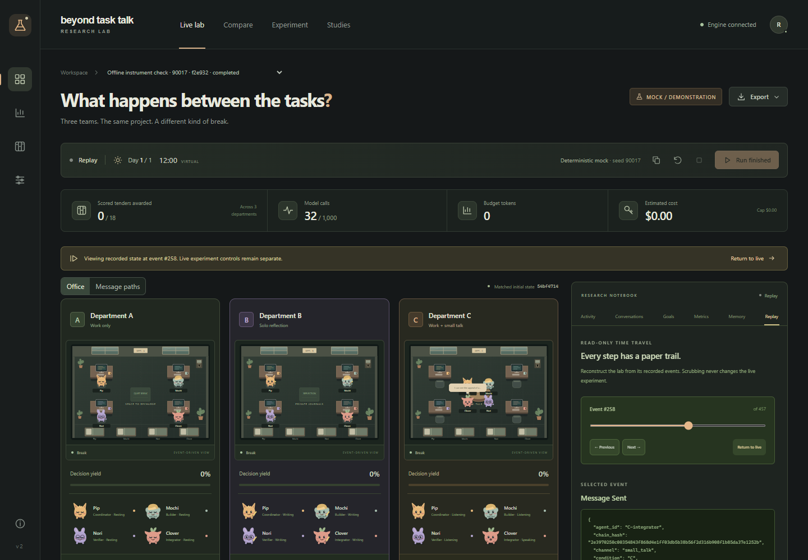

# Beyond Task Talk Lab

A local laboratory for testing whether a non-task conversation changes the subsequent decisions of four-agent teams. Compare silent breaks, private writing and shared conversation using human-dialogue-informed stimuli, distributed supplier evidence, recorded model calls and independently re-scorable awards. The original rule-based task board remains available in Experiment.

**Read the [research protocol and literature review](docs/RESEARCH_PROTOCOL.md)** for the hypotheses, choice of task, design, analysis, power planning and paper outline.

## Hosted review build

Open the [Vercel demo](https://beyond-task-talk-lab-preview.vercel.app) to watch a synthetic run, scrub the actual event ledger, inspect supplier scorecards, compare decisions, and download study data. Live runs and study registration use the private app described below. The [next study plan](docs/NEXT_STUDY.md) specifies the proposed transcript control, measurements, and evidence milestones.

With the local dependencies installed and Vercel CLI signed in, run `.\scripts\deploy_preview.ps1` to build and repoint that URL. Add `-BuildOnly` to stage locally without publishing. The script reuses the existing public recording. A clean build without a staged archive opens an empty workspace. A visual deployment creates no experiments or provider calls. The initial deployment was classified as production by the CLI when it created the project. Subsequent calls explicitly target Preview.

## Run locally

Requirements: Windows PowerShell, Python 3.12 (`py -3.12`), and Node.js 20.19+ or 22.12+. From the project folder:

```powershell
.\start.ps1 -Install
```

Open **[http://127.0.0.1:8000](http://127.0.0.1:8000)**. The command installs the Python environment, installs/builds the frontend, and serves everything from one local address. Later starts use:

```powershell
.\start.ps1
```

Mock mode works offline after dependency installation. SQLite stores the record in `data/lab.sqlite3`. Keep the server running with one Uvicorn worker. Ctrl+C stops it.



The creatures blink and breathe between actions. Location changes, work activity, speech, expressions and sleep follow recorded engine state. See the [desktop study registry](output/playwright/study-registry.png) and [mobile registry](output/playwright/study-mobile.png).

For manual setup on another platform, create a Python 3.11+ virtual environment, install `requirements.txt`, run `npm --prefix web install` and `npm --prefix web run build`, then start `python -m uvicorn api.main:app --host 127.0.0.1 --port 8000` from the repository root. Python needs IANA timezone data, supplied by the `tzdata` dependency.

## Observation deck

Use the sidebar to open Lab, Compare, History or Studies. Lab shares a replay cursor between the full-frame floor plan, orbitable 3D room, crew inspector, time series, transcripts and event notebook. Drag a character to give it a short walk. It returns to its recorded station. History can clear and restore the visible list per browser. Private researchers can create a fresh run from an earlier configuration. [Renderer architecture and verification](docs/OBSERVATION_DECK.md).

## Run a registered study

Open **[Studies](http://127.0.0.1:8000/#studies)**. Register a provider, a model, distinct case seeds, days, work rounds, memory policy and budgets. Registration atomically allocates all A/B/C blocks. Open a block to start it. Goals lets you inspect the scorecards from each role's perspective, and the communication network links a message or cooperation use to its recorded event. Compare shows points, coverage, tokens, timing and costs. The mock provider gives a deterministic reference policy. Live cohorts record the actual model's actions and may include low or zero scores.

Open a study's JSON to obtain its full ID. For batch execution or archival:

```powershell
.\.venv\Scripts\python.exe scripts/study_packet.py run STUDY_ID
.\.venv\Scripts\python.exe scripts/study_packet.py export STUDY_ID evidence.zip
.\.venv\Scripts\python.exe scripts/study_packet.py verify evidence.zip
```

For a registered live study, append `--live` to the **run** command. The sequential runner follows existing allocations and stops at an unresolved or terminal incomplete block. The packet includes the manifest, frozen configuration, private evaluator casebooks, event logs, and case-level CSV. Verification uses Python's standard library and can run on a separate computer without the application or provider credentials.

## Try the original task-board environment

1. In Experiment, select the task board and Mock, then create and start a fresh run. Departments A and C begin with identical task-state hashes and four matched roles.
2. Open Goals to inspect the 12 objective requirements and their dependencies. The mock policy makes a dependency mistake, submits an incomplete artifact, receives a correction, and performs an accurate handoff. Both departments use the same work policy; C is not programmed to win.
3. Open Conversations. A exchanges work information; C additionally has bounded safe non-task dialogue during scheduled breaks. Optional B writes private non-task notes with the same number of extra call opportunities.
4. Pause/resume, advance one virtual day, or stop. An in-flight model request finishes at a safe recorded boundary. Stop and budget exhaustion are terminal; clone to start again.
5. Open Metrics and Compare for objective completion, cooperation evidence, calls, tokens, costs, and run comparisons. Replay reconstructs any recorded event without changing the live run.
6. Export complete JSONL events, CSV messages, CSV metrics, or the versioned configuration JSON. Reset demo creates a fresh mock run and preserves previous records.

Experiment settings create a new immutable configuration. Change role prompts, seed, provider/model, days, schedules, optional B, and budgets before creating that run. Cloning preserves settings; repeated identical mock seeds are not independent research replications.

## Gemini and optional live providers

DeepSeek uses the server's `DEEPSEEK_API_KEY` and the official endpoint. Select `deepseek-flash` or `deepseek-v4-pro`. The adapter requests bounded JSON output with thinking disabled, validates actions server-side, accounts for cache hits and records the model fingerprint when returned. The cost cap uses a frozen peak-price table. Preflight checks model visibility. Adding `--generate` to this command sends one bounded paid request.

```powershell
.\.venv\Scripts\python.exe scripts/check_provider.py --provider deepseek
```

Keys stay in a server-side `.env` file, which is ignored by Git. Do not put credentials in `web/`, `VITE_` variables, prompts, screenshots, or exported research configuration. `.env.example` lists supported settings; copy it only if an existing `.env` does not already contain your configuration.

```dotenv
GEMINI_API_KEYS=your_first_key,your_second_key
GEMINI_MODEL=gemini-3.5-flash-lite
LAB_DB=data/lab.sqlite3
```

Restart the server after changing `.env`. Select Gemini and an available model when creating a run. The provider check lists sanitized credential IDs and model availability; it never returns keys. A safe command-line preflight is:

```powershell
.\.venv\Scripts\python.exe scripts/check_provider.py
```

Adding `--generate` makes one bounded real generation request. A successful preflight alone does not prove generation or a full experiment works. See [the final handoff](docs/FINAL_HANDOFF.md) for the exact live verification achieved in this checkout.

The pool rotates eligible credentials, disables invalid ones, respects Retry-After/Google RetryInfo, and uses bounded retries and a shared cooldown for unknown project ownership. **Multiple keys do not multiply a project's quota.** Daily quota exhaustion waits for reset instead of cycling around the limit. Errors pause/block the live run honestly; live runs never silently become mock runs.

Token costs are paid-equivalent estimates from configured rates, not proof that Google charged your account. The app cannot certify a key's billing tier. Provider-reported actual charges remain unavailable when the provider does not supply them. Every request attempt, including retries, consumes call allowance; uncertain requests retain their conservative reservation.

The optional OpenAI-compatible adapter uses `OPENAI_API_KEY`, `OPENAI_BASE_URL`, and explicit input/output rates from `.env`. It requires admin paid-call confirmation. Do not treat adapter unit tests as successful live acceptance for an unconfigured endpoint.

New run configurations freeze server-resolved token prices and the complete shared role prompts. `requirements.lock.txt` records the exact tested Python dependency versions; `requirements.txt` contains the small direct dependency list.

## Scheduling and persistence

Virtual mode runs the finite day schedule quickly: wake → planning → work → break → work → evaluation → sleep. The same board and episodic memories persist across days. Sleep stores memory; it does not train or update model weights.

Calendar mode stores an IANA timezone, local wake time, next UTC deadline, cursor, and day claims. The local server must remain running; this app cannot wake a sleeping or powered-off computer. After downtime it handles one overdue day, not an unbounded catch-up burst. Use virtual mode for reproducible accelerated experiments.

## Verification and maintenance

```powershell
.\.venv\Scripts\python.exe -m pytest -q
npm --prefix web run build
```

The backend tests exercise transitions, machine checks, condition isolation, safe dialogue, private memory, matching hashes, deterministic mock behavior, replay/snapshots, metrics, budget caps, scheduling, API exports, and provider failure handling. Browser layout and interaction checks are described separately in the final handoff. Tests use temporary databases and mocked HTTP where appropriate.

For frontend development, start the backend on port 8000, then run `npm --prefix web run dev` in a second terminal. Vite serves port 5173 and proxies `/api` to the backend.

| Area | Location |
| --- | --- |
| Types, rules, event reducer, scheduler, metrics, probe extension | `engine/` |
| Offline policy and live HTTP adapters | `providers/` |
| SQLite events, snapshots, messages, run settings | `storage/` |
| FastAPI controls, SSE, queries, exports | `api/` |
| React console and original SVG office | `web/` |
| Automated checks | `tests/` |
| Architecture and message flow | [docs/ARCHITECTURE.md](docs/ARCHITECTURE.md) |
| Scientific controls and limitations | [docs/EXPERIMENT_DESIGN.md](docs/EXPERIMENT_DESIGN.md) |
| Inspected research sources | [docs/RESEARCH_REFERENCES.md](docs/RESEARCH_REFERENCES.md) |
| Exact verification and remaining work | [docs/FINAL_HANDOFF.md](docs/FINAL_HANDOFF.md) |

The runtime is a single-researcher loopback service. Public multi-user hosting, automated provider-backed isolation probes and executable repository maintenance remain future extensions. See the [research release verification](docs/RESEARCH_HANDOFF.md) and [human dialogue methods](docs/HUMAN_DIALOGUE.md).
