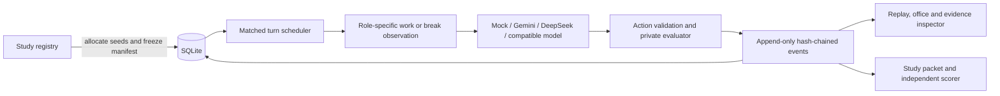
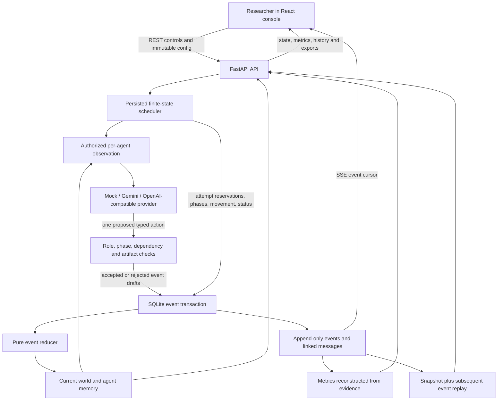

# Architecture and maintenance guide

## Research release



| Module | Responsibility |
|---|---|
| `engine/study.py`, `api/studies.py` | Validate prospective registrations, freeze content hashes, model rates, runtime versions, corpus and analysis plan. Allocate matched runs atomically. Report contrasts, missing blocks and interval conditions. |
| `engine/procurement.py` | Generate matched private supplier scorecards, project each role's observations, enforce disclosure/request/award permissions, grade irreversible decisions and supply a deterministic reference policy. Practice closes at the first break. |
| `engine/dialogue.py`, `engine/topical_chat_v1.json` | Human-derived transition counts drive the same surface-move schedule in B and C. The controlled rendering takes the actual preceding choice into account. A work projection can include named, anonymized or withheld break memories. |
| `providers/deepseek.py`, `providers/openai.py` | DeepSeek uses native JSON mode on its compatible endpoint. The shared transport isolates credentials and retains usage, request digests, model version/fingerprint and uncertainty. |
| `storage/store.py` | Study-to-seed allocation and genesis events share a transaction. New event envelopes include previous and current SHA-256 digests. Full audit replays from genesis and compares every stored snapshot and final materialized state. Historic MVP events retain their original format. |
| `scripts/study_packet.py` | Execute already registered runs, export a consistent event prefix for each block, verify the envelope chain, and independently re-score every choice from four numeric scorecards. An archive can be checked without backend dependencies. |
| `scripts/fit_dialogue_profile.py`, `scripts/validate_dialogue.py` | Refit counts from a pinned train split and measure generated surface features against a held-out human split. |
| `web/src/Studies.tsx`, `TenderEvidence.tsx`, `MessagePaths.tsx`, `Creature.tsx` | Register blocks, interpret recorded outcomes, inspect what each role could see, trace addressed messages and display action-derived poses. No browser action supplies a task score. |

New endpoints include `GET/POST /api/studies`, `GET /api/studies/{id}`, `GET /api/studies/{id}/export`, `GET /api/runs/{id}/casebook` and `GET /api/runs/{id}/audit`. Private evaluator data is available to the local researcher. Agent providers receive a role-specific observation. The execution guard compares the backend source digest and installed runtime versions before starting or resuming an allocated block. Preserve the matching checkout and dependency lock. Hash-chaining supports integrity checks against an independently saved digest. External attestation requires saving the digest in a service independent of the local operator.

The remaining sections document the original shared engine and task-board environment. The paper-facing design and scoring rules are in [the research protocol](RESEARCH_PROTOCOL.md).

## What this application does

Beyond Task Talk Lab runs matched groups of four software-project agents in a small, explicit world. Agents submit typed requests; the engine decides whether those requests are valid. A task is successful because a deterministic evaluator accepted its structured artifact, never because an agent said it was successful. The browser displays that recorded world and offers research controls. Its office animation has no causal role in the experiment.

The MVP uses Python 3.12, FastAPI/Pydantic, SQLite, React, TypeScript, and Vite. HTTP providers use `httpx`. There is no vector database, external worker queue, Redis, orchestration framework, or game engine. One local Python process serves both API and built frontend. This deployment is deliberately small and should use one Uvicorn worker.



## Important modules

| Module | Responsibility |
| --- | --- |
| `engine/domain.py` | Pydantic configuration, four roles, conditions, strict discriminated action types, safe dialogue vocabulary, and action JSON Schema. Rejects extra action fields. |
| `engine/world.py` | Constructs matched initial boards and agent knowledge; creates authorized observations; validates actions; executes deterministic artifact scenarios; returns event drafts without mutating input state. |
| `engine/reducer.py` | Pure application of one committed event to a copied state. Updates tasks, activities, locations, cursor, status, and visibility-scoped memories. Used for both live execution and replay. |
| `engine/scheduler.py` | Builds the finite day schedule, advances its durable cursor, controls pause/resume/stop, handles calendar deadlines/leases, reserves budgets, dispatches one provider attempt, and records retries and outcomes. |
| `engine/metrics.py` | Derives outcomes, costs, calls, retries, uncertainty, elapsed clocks, and cooperation counts from raw events. No sentiment-based relationship score. |
| `engine/probes.py` | Matched probe specifications, deterministic scoring, and an evaluator-callback runner using isolated copies. Automatic model probe sessions are not scheduled by the MVP. |
| `providers/mock.py` | Deterministic offline work policy and safe dialogue selection. Contains bounded mistakes, repair, and handoff examples. Same work policy across conditions. |
| `providers/base.py` | Safe provider errors, observation-to-prompt conversion, JSON Schema conversion, action decoding, usage parsing, and configured price calculations. |
| `providers/gemini.py` | Server-side credential pool, sanitized health, model preflight, quota-aware key selection, error classification, and one Gemini HTTP generation attempt. |
| `providers/openai.py` | Optional stateless OpenAI-compatible chat adapter with explicit paid-run confirmation and usage accounting. |
| `storage/store.py` | SQLite schema, transactional append, immutable events/messages, current-state cache, snapshots, filtered reads, replay, day claims, and scheduler leases. |
| `api/main.py` | Application lifespan, local-origin checks, REST controls/queries, reconnectable SSE, real-data exports, run comparisons, and frontend static serving. |
| `web/src/api.ts`, `types.ts` | Typed browser HTTP helpers and presentation types. They do not implement task-world acceptance rules. |
| `web/src/App.tsx` | Selected-run lifecycle, SSE subscription, controls, navigation, replay requests, and export navigation. |
| `web/src/Office.tsx`, `Icon.tsx` | Original SVG creatures, office rendering, and icons. Activity and movement come from backend state. |
| `web/src/Inspector.tsx` | Recorded activity, conversations, goals, objective metrics, memories, cooperation graph, and replay inspection. |
| `web/src/Experiment.tsx`, `Compare.tsx` | New immutable experiment configuration and recorded run comparisons. |
| `scripts/check_provider.py` | Sanitized Gemini preflight and optional one-request live diagnostic. Never prints credentials. |
| `start.ps1` | Creates the Python environment, installs/builds the frontend when requested, and starts loopback Uvicorn. |
| `tests/` | Domain/replay/evidence, persistence/scheduling/budgets, API/export, and provider HTTP-contract tests. |

Configuration examples are in `.env.example`; actual credentials belong only in the ignored `.env`. Generated files live in `.venv/`, `web/node_modules/`, `web/dist/`, and `data/`. Documentation in `docs/` separates inspected research, experimental design, architecture, and final verification.

## A turn, from observation to recorded result

The scheduler reads the current run, frozen configuration, and integer schedule cursor. A schedule entry identifies the day, phase, work round, department, and role. Each department has four agents with role-prefixed IDs such as `A-builder`.

Before a work turn, `context_for_agent` copies the department's board, the acting agent's own recent memory, same-department agent identities, relevant help requests, and authorized formal rule knowledge. It never includes another department or another agent's private journal. Role instructions and action schema tell a provider which single action it can propose.

Before network dispatch, the scheduler records a provider-attempt ID, logical turn ID, prompt hash, and conservative token/cost reservation. The provider receives the authorized observation, not a database handle or the full world. It returns one action and usage metadata. Live output is not trusted: Pydantic rejects unknown fields/invalid shapes, and world rules enforce role, phase, task membership, current artifact version, and dependencies.

`process_action` returns drafts such as `action_accepted`, `action_rejected`, and `message_sent`. An accepted task update includes the complete replacement task and objective evidence. A rejection records why the action failed and changes no task state. The acting agent remembers its attempt and the reason/evidence so it can correct a misunderstanding on a later turn.

The store commits provider outcome, activity, action/message events, current state, and new cursor in a short transaction. Every draft passes through the same reducer used by replay. No external request is awaited while a SQLite transaction is open. The browser receives committed events through SSE and refreshes state/metrics through the API; it never awards completion itself.

## The task environment and evaluator

There are 12 dependency-linked milestones: schema, create, list, status, assignment, permissions, audit, export, import, dependencies, regression, and release. Each has a visible acceptance criterion and required declarative behavior rules. Artifacts use this small interface:

```json
{"feature":"assignment","rules":["assign_known_user","reject_unknown_user"]}
```

These are **feature-rule artifacts in a toy interpreter**, not Python/JavaScript implementations. The evaluator runs fixed example scenarios and compares actual/expected results: blank titles, unknown status/users, ownership checks, preserving audit history, private-field exclusion, duplicate imports, unfinished dependencies, and manifest coverage. Missing rules fail their scenario. The final regression/release milestones validate declarative coverage/manifests; they are not executions of a generated application's hidden test suite.

The lifecycle is `available → claimed → submitted → verified → integrated`. The Coordinator assigns an available milestone only after its prerequisites are integrated. The Builder submits a current artifact. The Verifier runs machine checks; failure returns it to `claimed` for repair. The Integrator completes only a verified current version with integrated dependencies. A self-declared `passed: true` cannot satisfy the schema or bypass evaluation.

The offline policy deliberately attempts a dependency too soon, omits a formal schema rule, receives a valid correction, and waits for a versioned handoff. These are explicit synthetic examples. Seeded work selection is condition-blind. A/C need not differ in objective outcomes; different communication traces are sufficient for the demonstration.

## Experimental conditions and memory

All arms share initial project content, matched role templates, seed, model/configuration, and allowable work opportunities. Their initial **task** hash excludes condition metadata and department-prefixed IDs. The full configuration has its own canonical SHA-256 hash. Configuration is immutable after creation; create or clone another run to change it.

- **A: work only.** No non-task model turns occur during breaks.
- **B: optional solo journaling.** Each agent privately selects a safe non-task line; only its own prior notes enter later journal observations.
- **C: shared non-task dialogue.** Each agent sees the current day's preceding safe table lines with speaker name/role and may choose an opening line or vetted reply.

Break observations exclude boards, work memories, artifacts, task status, and work prompts. They contain a finite safe utterance catalog, plus C's safe social history or B's own private notes. The model chooses an utterance ID; the engine renders its vetted text. Arbitrary free text and project hints cannot be smuggled through extra JSON fields. This strong control makes the MVP's dialogue less natural and less general than unconstrained social conversation; research must acknowledge that limitation.

Work messages use the `work` channel, C messages use `small_talk`, and B journals use `notes` with private visibility. Work-message visibility is sender plus recipient; table visibility is the department. The researcher can inspect recorded journals, but other agents cannot. Episodic memories retain up to 200 entries per agent; work prompts use a bounded recent window. Sleep preserves board and memory state without changing model weights or implementing Google's research training framework.

Formal knowledge is explicit in this toy world. The Builder initially lacks one formal schema-rule ID; a valid sender can transfer it. This is a controlled symbolic information gap, not a claim about measuring all knowledge latent in an LLM. The researcher-facing board may show more information than a particular agent's authorized observation.

## Scheduling, concurrency, and recovery

Each virtual day contains wake, planning, work block 1, break, work block 2, evaluation, and sleep. Work turns cycle through the four roles with a balanced department order. A/C receive equal work opportunities; B/C receive equal numbers and output limits of extra non-task calls. Real token lengths and retry counts may differ and are reported. Planning/evaluation are scheduler checkpoints, not additional hidden model calls.

Virtual mode uses accelerated ticks. Presentation speed does not change the simulated clock or determine task results. Calendar mode stores a user-selected local wake time, IANA timezone, and next UTC deadline. SQLite leases coordinate the active local scheduler, and day-job keys record scheduled day starts. The server must be running; operating-system wake and external reliable job hosting are outside this MVP. An overdue run advances one day, then schedules its next local wake instead of issuing unlimited missed days.

Pause/stop requests are persisted. An in-flight attempt records its response, usage, and action at a safe boundary; the loop then acknowledges paused/stopped without dispatching another turn. The durable cursor permits resume. Completed, stopped, and budget-exhausted runs are terminal; cloning starts a fresh configuration copy.

On restart, interrupted active runs are recovered to a resumable checkpoint. An attempt recorded before dispatch but lacking a final outcome is uncertain: the app cannot know whether the remote provider processed it. Recovery logs that uncertainty and retains the maximum reservation. Domain events are not applied twice because only committed cursor advancement moves to the next turn. This is not a claim of exactly-once remote LLM billing across a network failure.

## Persistence, hashes, and replay

SQLite runs in WAL mode. The important tables are:

| Table | Contents |
| --- | --- |
| `runs` | Frozen configuration/hash, initial task hash, current state/sequence, schedule deadlines, control request, and lease metadata. |
| `events` | Immutable ordered event envelopes, indexed by run/sequence and filter columns. All required event fields remain in the JSON envelope, including usage and hashes. |
| `messages` | Plain-language messages linked to their immutable source event, with channel, visibility, and recipient. |
| `snapshots` | State/hash at sequence 0 and periodic later checkpoints. A cache to accelerate reconstruction, not another source of experimental actions. |
| `day_jobs` | Unique run/day start records for calendar scheduling. |

The complete event envelope contains event/run/department/agent IDs, condition, virtual day, sequence, UTC timestamp, type/channel/task, payload, provider/model, prompt hash, input/output tokens, estimated cost, elapsed provider milliseconds, severity, and resulting state hash. Unknown usage or billing is null rather than fabricated.

Triggers reject updates/deletes to events and messages. A new demo preserves older histories. Current state is a materialized cache produced by the reducer. Canonical JSON hashing sorts keys and avoids presentation formatting; UTC event timestamps and random event IDs do not drive the task world.

Replay starts from the latest snapshot at or before a requested sequence and applies subsequent events through `reduce_event`. The returned replay state is read-only. Replaying or animating historical events never performs provider calls, changes live memory, or changes the run cursor.

Back up the whole `data/` directory only while the server is stopped, or use SQLite's online backup mechanism. Copying only an actively written `.sqlite3` file may omit WAL changes. There is no general migration framework yet; future schema upgrades need explicit versioned migrations and backup/replay checks.

## Providers, retry rules, and cost semantics

Mock is the safe default and performs no network calls. Gemini and the OpenAI-compatible adapter implement the same one-attempt generation contract: proposed action, model, prompt hash, token counts, latency, and estimated/reported costs. Provider failures expose application-owned classifications, never raw request headers or credential-bearing responses.

The Gemini pool keeps secrets server-side, de-duplicates keys, rotates eligible credentials, disables authentication failures, and honors Retry-After and Google's RetryInfo. Unknown project ownership shares a cooldown because quotas are project-scoped. Daily exhaustion waits for reset; more keys are not treated as more quota. The scheduler owns bounded retries, logical turn IDs, and persistent retry deadlines.

Every dispatch consumes a call allowance. Before dispatch, the engine reserves a conservative UTF-8 prompt/token bound, maximum output, and configured estimated cost. Reservations for uncertain outcomes remain held. At matched work-group boundaries the scheduler checks allowance for the matched group, then checks individual attempts as well. Very small caps may end a run before further work. No live-to-mock fallback occurs inside a run.

Costs distinguish **paid-equivalent estimate**, **actual provider-reported charge**, and **unknown/uncertain reservation**. Free-tier account eligibility is not inferred from a key. The app does not obtain a billing invoice from Gemini. OpenAI-compatible calls require explicit paid confirmation and known server-side rates; other models require configured rates before a conservative monetary estimate can be enforced. A local configured estimate is not a provider-enforced financial limit.

## Metrics and research probes

Task outcomes come first: integrated milestones/total, completion fraction, rejected actions, dependency blocks, model attempts/retries, tokens, simulated elapsed minutes, wall-clock duration, provider latency, and costs. Wall-clock duration comes from event timestamps; provider latency is a separate sum; simulated minutes come from global day/phase markers.

Cooperation uses objective evidence:

- Useful help requires a sender-known correct formal rule that the recipient lacked, followed by actual successful use of that rule in a submitted artifact scenario.
- Repair additionally links the corrective rule to a previously failed scenario.
- An accurate handoff requires a current versioned artifact message later consumed by the matching verifier review.
- Cooperation graph edges count those validated uses, deduplicated by task/participants/rule or artifact version.
- Duplicate claims prevented count engine rejections. This is an engine protection, not proof of cooperative intent.

No sentiment-derived trust, friendship, relationship percentage, or artificial p-value exists. Run-comparison aggregates expose n and standard deviation when repeated completed runs are available. Repeating the same deterministic seed does not create independent evidence; mixed configurations/providers must not be pooled into a causal estimate.

`engine/probes.py` establishes four matched probe types: information transfer, costly help in simulation units, misunderstanding repair, and handoff accuracy. It provides day-1/3/5 conventions, matched task hashes, isolated copies of agent memory, deterministic scoring, hidden-result flags, and `probe_started`/`probe_scored` drafts. An explicit evaluator callback must orchestrate responses. Automatic provider-run probes and UI scheduling are deferred. Probe events have no reducer path that injects scores into team memory.

## API and frontend contract

FastAPI exposes interactive API documentation at `/docs` and the schema at `/openapi.json`. Principal routes:

| Method and path | Meaning |
| --- | --- |
| `GET /api/health` | Sanitized provider configuration and service status. |
| `POST /api/providers/check` | Server-side Gemini credential/model preflight. |
| `POST /api/preview` | Configured call/token/cost ceilings before creating a run. |
| `GET/POST /api/runs` | List histories or create a new frozen configuration. |
| `GET /api/runs/{id}` | Current backend state, hashes, metrics, and budget usage. |
| `POST /api/runs/{id}/control` | `start`, `pause`, `resume`, `stop`, or `advance_day`. |
| `POST /api/runs/{id}/clone` | Create a fresh ready run with the same configuration. |
| `GET /api/runs/{id}/events` | Search/filter by department, day, agent, channel, task, event type, severity, sequence, and text. |
| `GET /api/runs/{id}/messages` | Recorded conversation events. |
| `GET /api/runs/{id}/metrics` | Metrics derived from recorded events. |
| `GET /api/runs/{id}/replay?seq=...` | Reconstruct a historical state/hash and metrics. |
| `GET /api/runs/{id}/stream` | SSE with sequence IDs and Last-Event-ID reconnection. |
| `GET /api/runs/{id}/export/{kind}` | `events.jsonl`, `messages.csv`, `metrics.csv`, or `config.json`. |
| `GET /api/compare?ids=...` | Recorded run details and matched-configuration summary. |

The office is SVG plus CSS transitions. Agent locations/activities come from committed phase, movement, work, talk, and sleep events reduced into backend state. The browser handles layout, navigation, filters, export downloads, and animation timing. It can deduplicate SSE sequence IDs and request a fresh state, but it cannot validate an artifact, invent a message, or alter a milestone locally. Reduced-motion styling should suppress decorative movement without changing experiment execution.

The API binds to loopback and rejects browser writes from unexpected origins. It is not an authenticated multi-user hosting service. Authentication/authorization, durable hosted scheduling, deployment monitoring, and broader security hardening are required before public access.

## Tests, extensions, and safe changes

Run `python -m pytest -q` using the virtual environment, then `npm --prefix web run build`. Domain tests verify matching initial state, invalid transitions, evaluator failures, role isolation, bounded break text, private journals, social reply context, deterministic mock traces, full/snapshot replay, metrics, actual cooperation use, and probe-copy isolation. Persistence/scheduler tests cover append-only records, checkpoints, schedule, recovery, caps, and control boundaries. Provider tests simulate HTTP success/failure, retry timing, quotas, key redaction, and malformed data. API tests cover real endpoints and exports. Actual browser inspection and live-provider acceptance require separate evidence; consult `FINAL_HANDOFF.md` for what was exercised.

To add a condition, extend configuration/condition validation, initial-state creation, break-turn scheduling and context visibility, then presentation labels. Keep work opportunities matched. Add tests proving no new cross-arm/private context paths before comparing outcomes.

To add a provider, implement one-attempt `generate(context)` returning the existing result fields, route construction in the scheduler, and define pricing/error/usage behavior. Keep retries and reservations in the scheduler. Unknown usage remains unknown; do not introduce browser-side keys. Test with fake HTTP before making a bounded explicitly authorized live call.

To add a task environment, replace the milestone definitions, artifact type, and deterministic evaluator behind the world functions. Preserve accepted/rejected event contracts and shared reducer/replay. A future executable repository environment needs sandboxed Docker workspaces, restricted actions, hidden tests, immutable starting commits, failure cleanup, and evaluator version hashes. It should report those outcomes separately from this declarative simulator.

For publication-quality work, pre-register outcomes and stopping rules, run enough independent team-run replications, randomize/balance scheduling, retain matched seeds/tasks, use an extra-call control such as B, audit chat leakage, version prompts/providers/evaluators, run isolated probes, record missingness/retries, and calculate uncertainty with an appropriate analysis plan. This MVP supplies instrumentation and controls; it does not establish a causal finding.
