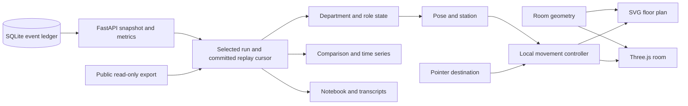

# Observation deck

The Lab page follows one real department in one saved run. The public preview opens the existing synthetic procurement recording at its first recorded table message. Open [the work checkpoint](https://beyond-task-talk-lab-preview.vercel.app/?scene=3d&moment=work) to see the verifier's first recorded work turn in the 3D room. The replay banner identifies the selected event. **Return to results** shows the final state. **History → Replay from start** opens event zero. The private workspace can open recorded provider runs, execute an explicitly configured experiment, and compare independent runs.

## From a record to a room



| Module | Responsibility |
| --- | --- |
| `App.tsx`, `api.ts`, `types.ts` | Own the selected run, config, state, frozen metric snapshot, sequence, and event pages. A local run uses FastAPI and SSE. The hosted viewer resolves reads to static archive files. |
| `world/Deck.tsx` | Hosts the featured room, synchronized overview of the configured arms, crew inspector, scene initialization and controls. Condition D has a display identity for future records. The current engine creates A/B/C only. |
| `world/layout.ts`, `world/art.ts` | Describe stations, furniture solids, shared wall illustrations, floor bounds, and station destinations in room coordinates. The vector renderer projects each object. The 3D renderer instances the same solids and textures the illustrated panels. |
| `world/motion.ts` | Finds a path on a quarter-unit floor grid around furniture and inset bounds. A manual drop schedules an outbound walk, a short pause, and a return to the recorded station. A new engine location supersedes a manual excursion. A rewind resets local positions. |
| `Creature.tsx`, `world/crew3d.ts` | Draw the four crew members and map recorded phase, location, work actions and messages to poses. Speaking is tied to a recorded table message. The builder alternates key presses, the verifier scans a sheet and the coordinator and integrator write. The 3D rig controls the neck, eyelids, paws, feet, equipment and tail. Idle glances and hand motions are illustrative. |
| `world/Room2D.tsx`, `world/Room3D.tsx`, `world/framing.ts` | Render the floor plan and its colored 3D cutaway and perform pointer picking. The 3D canvas fills the scene rectangle. The orthographic camera fits the finite floor, walls, workstations and beds at its original three-quarter angle. Resizing preserves manual zoom and focus. Reset camera restores the whole-room view. The 2D view is available when WebGL fails. |
| `TeamReadout.tsx`, `Analytics.tsx`, `Distribution.tsx`, `MessagePaths.tsx` | Expose outcomes, usage, and message counts by arm, interval charts, latency histograms and links from communication edges to their source events. |
| `replayBuffer.ts`, `scripts/pack_public_replay.py` | The browser retains up to 48 exact checkpoints. The public archive packages 16 adjacent snapshots per request. Private playback reads ahead four individual FastAPI snapshots. Rapid scrubbing coalesces uncached requests. The previous frame stays visible until the next recorded state and metrics arrive together. |
| `ChatTranscript.tsx` | Displays chronological messages, speaker alignment, UTC times, channel and day dividers, private journal boundaries and expandable raw event receipts. |
| `ComparePlots.tsx` | Places teams on resource-versus-outcome axes, combines coincident points into segmented markers, and colors a condition matrix independently by column. The replication plot uses the backend configuration groups and reported sample standard deviations. |
| `History.tsx`, `Inspector.tsx`, `TenderEvidence.tsx` | Manage the saved list, raw configurations, integrity audits, searchable activity, event payloads, memories, message timestamps, case evidence and exports. |
| `Compare.tsx`, `Studies.tsx`, `Experiment.tsx` | Retain the multi-run comparison, matched-block registry, provider selection, budgets and private experiment controls. |
| `src/vendor/GridScan/` | Official React Bits TS/CSS implementation at commit `a30a9da9b40a91c5672fc8cd77785719e8e5b1e6`. The scan loads separately, with camera and gyro input disabled. The integration adds completion and graphics-failure callbacks. Department switches wait for the 1.6-second delay and the entire 2.4-second sweep before revealing the destination. Reduced-motion preferences bypass the scan. The component's license is included in source and public assets. |
| `TechHeading.tsx`, `vendor/TechText/`, `world/DepartmentTransition.tsx` | The compact heading uses React Bits TechText from the same pinned revision. A plain heading supports reduced motion. The department transition owns the scan lifetime and fallback. Replay navigation uses neither animation. |
| `deck.css`, `public/assets/fonts/` | Responsive layout, motion preferences and self-hosted Bricolage Grotesque and DM Sans with their font licenses. |

File paths in the table are relative to `web/src/`, except for `web/public/assets/` and the explicit vendor path. Browser scene components have no mutation API. Changing a camera, selecting a pet or dragging to the table cannot initiate provider calls, reveal new facts to agents or write an event.

## Appearance and side-by-side viewing

The header switch cycles through Dark, Light and Classic blue. A fresh browser starts in Dark. The preference is stored locally and also applies to saved replays. The room materials, crew designs and condition colors persist across all three themes. Light mode uses darker series colors for legibility on paper-colored panels.

The R button opens the workspace information dialog. Its circular surface uses Soft Aurora. Two slow Strands cross the header background, and a fine pointer leaves a short, translucent Splash Cursor trail. `Atmosphere.tsx` loads these visual effects independently of the experiment. Reduced motion uses the static orb, and touch devices keep the native touch interaction. The JavaScript and CSS are vendored locally. Soft Aurora and Strands come from the React Bits JS/CSS registry, and Splash Cursor uses the supplied component source. The React Bits license ships in the public assets. [Soft Aurora](https://reactbits.dev/r/SoftAurora-JS-CSS.json) · [Strands](https://reactbits.dev/r/Strands-JS-CSS.json) · [Splash Cursor](https://reactbits.dev/animations/splash-cursor)

**Compare all** folds away the inspector. Each configured department gets its own column and room preview. Outcomes, Usage and Channels use the same measurement definitions as the compact readout. Each column can reveal its latest work message and jump to the event. Selecting a room restores the inspector. A brief particle transition accompanies the change when motion is enabled.

The browser accepts `?run=<saved-run-id>#conversations` for opening a saved transcript. The selected run must exist in that workspace. Procurement work messages carry private score disclosures. Under the current protocol, Department C's break topics come from a bounded non-task catalog. Initializing a goal does not change that treatment.

The theme and comparison browser regression is in `output/playwright/ui-themes.js`. At a 1440-pixel viewport the three room columns measured 347 pixels each. At 390 pixels all three shared the same row with no page overflow. The graphics check covers mesh picking, a walk started in 3D and completed in 2D, return to station and the WebGL fallback. The restored camera was visually checked on both viewport sizes.

## Reading the measurements

- The department readout compares arms at the displayed event. Outcomes includes earned yield, awards, published scores, and work turns in procurement. The milestone environment substitutes task completion and handoffs. Usage distinguishes estimates from provider-reported charges. Channels separates work, table talk and private journals.
- The day-filtered yield chart counts points awarded in that interval against all scheduled attainable points for the department. It uses event sequence on the horizontal axis. The optimal award rate uses the number of scored awards as its denominator. An interval with no awards has no rate.
- The latency histogram and nearest-rank p50/p90 use recorded attempt durations. An offline run has no live provider latency. Cost per award uses estimated cost divided by the number of scored awards in the selected interval. Provider billing is available only if reported.
- A directed message contributes an edge to its named recipient. A departmental broadcast terminates at a department node. The network shows distinct work, table, and observed cooperation paths. It draws no private journal edges. Select a connection to inspect a supporting event.
- The procurement record can prove which private scores were disclosed and which external scores were available when an award was made. It cannot establish the model's internal use of an available fact. The inspector labels this limitation.
- A researcher's History list can be cleared and restored in the same browser. SQLite ledgers, registrations, hashes and exports survive clearing. Restarting a saved mock configuration creates a fresh ready run. Restarting a paid configuration opens the controls for explicit configuration and cost confirmation.

## Verification and local use

Run `.\start.ps1 -Install` from the repository root and open `http://127.0.0.1:8000`. A fresh database starts empty. Configure an experiment or register a study to create the first record. To update an installed frontend, run `npm --prefix web run build`.

The release checks used the following commands on Windows with Node 22.18 for the TypeScript camera test.

```powershell
.\.venv\Scripts\python.exe -m pytest -q
npm --prefix web run build
node --test web/tests/framing.test.mjs
.\scripts\deploy_preview.ps1 -BuildOnly
```

Serve the staged archive to exercise the files Vercel receives.

```powershell
.\.venv\Scripts\python.exe -m http.server 8055 --bind 127.0.0.1 --directory .verification/vercel/beyond-task-talk-lab/.vercel/output/static
npx --yes --package @playwright/cli playwright-cli open http://127.0.0.1:8055
npx --yes --package @playwright/cli playwright-cli run-code --filename=output/playwright/ui-hosted.js
npx --yes --package @playwright/cli playwright-cli run-code --filename=output/playwright/ui-graphics.js
npx --yes --package @playwright/cli playwright-cli run-code --filename=output/playwright/ui-presence.js
npx --yes --package @playwright/cli playwright-cli run-code --filename=output/playwright/ui-heading.js
```

The archive QA uses the existing one-day A/B/C recording. On a clean checkout the publishing script builds an empty archive. To explicitly generate separate synthetic test data, direct `scripts/build_public_demo.py --output` to a disposable directory. Never point an export at a private study database.

`output/playwright/ui-private.js` exercises start, pause, resume, restart and selection persistence against a disposable mock database on port 5173. Its read-only checks on port 8000 require an existing completed DeepSeek procurement recording. A fresh checkout cannot reproduce that historical calibration without obtaining an equivalent recording. The backend suite covers replay integrity, hard caps, provider failures, arm isolation, scheduling and scoring without paid calls.

Browser verification used Chromium at 1440×1000 and 390×844. It included a genuine WebGL room, a raycast drag carried across renderers, returning to station, reduced motion, an unavailable-WebGL fallback, filtered logs, evidence, usage, downloads, an empty run list and reversible history clearing. Desktop, mobile and 3D captures are in `output/playwright/`. Physical-device GPU performance, Safari and Firefox remain unmeasured.

The final backend suite passed 67 tests. The camera test checked all corners in 108 department/angle/aspect combinations. The staged public archive contained 458 checkpoints in 29 playback pages, each matching its original event snapshot. With a 300 ms artificial delay per page, 19 consecutive events played with three additional page requests and zero scene reinitializations. All four recorded table messages matched the source text and event IDs. Browser checks included a complete GridScan sweep, fallback on unavailable WebGL, a responsive TechText heading, provider-cost missing states and the three comparison plots.

The hosted, private, graphics, presence, heading, controls, registry and smoke browser checks used the scripts under `output/playwright/`. Controls/registry/smoke targeted a disposable SQLite workspace on port 5173. The saved private DeepSeek calibration still contained 1,740 events after its read-only browser checks. No provider was invoked for these checks.

## Deployment and boundaries

`.\scripts\deploy_preview.ps1` builds a read-only review site and updates the stable Vercel preview alias. It reuses the existing staged public archive and creates no new runs. Private data, API keys and write endpoints belong to the loopback FastAPI installation. The room and its animations have no role in experimental treatment or productivity scores.

[TechText](https://reactbits.dev/text-animations/tech-text) · [Official GridScan component](https://reactbits.dev/backgrounds/grid-scan) · [Official source revision](https://github.com/DavidHDev/react-bits/tree/a30a9da9b40a91c5672fc8cd77785719e8e5b1e6/src/ts-default/Backgrounds/GridScan) · [Experiment design](NEXT_STUDY.md)
